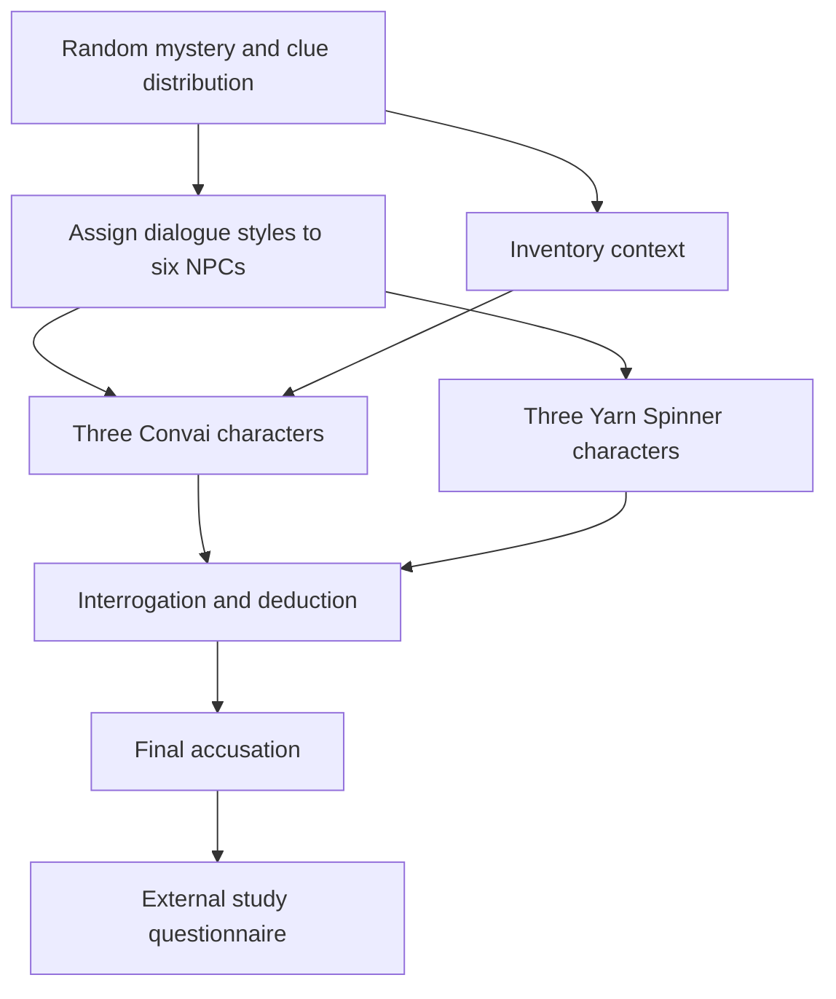

# Detective Convai

Detective Convai is a Unity investigative game prototype developed for my undergraduate Computer Science thesis at **UNIVALI (2024)**, *Evaluating the Impact of AI Character Engines on Player Immersion in an Investigative Game*. The project explores how players experience two approaches to non-player character (NPC) dialogue: dynamic conversations through Convai and authored dialogue trees through Yarn Spinner.

The game takes place at a mansion after a murder. Players question guests and use clues to deduce the culprit, weapon, and location before making a final accusation. The prototype was created as a playable research instrument.

## How the prototype works

- A new game randomly selects the culprit, weapon, and location, then distributes the remaining clue cards among the player and NPCs.
- Six guests are assigned dialogue styles at random for each game: three use Convai and three use Yarn Spinner dialogue trees.
- Convai conversations allow free-form text or voice input; Yarn Spinner offers authored choices. Both approaches are integrated into the same investigation loop.
- Players can inspect clues, question characters, make suggestions that may reveal contradictory cards, and submit a final accusation. NPCs also take turns and can make suggestions and accusations.
- Character dialogue is connected to the current game state by communicating NPC inventory information to Convai during setup.

The main gameplay logic is in [`Assets/Scripts`](Detective_Convai/Assets/Scripts): `GameController.cs` handles clue selection and distribution; `InterrogationController.cs` chooses and switches dialogue styles; `SuggestionSystem.cs`, `NPCAI.cs`, and `FinalAccusation.cs` handle deduction and turn outcomes. Authored scripts are in [`Assets/YarnSpinner`](Detective_Convai/Assets/YarnSpinner).

## Dialogue architecture

## Technology and project structure

- **Unity 2022.3.48f1** and C# (`Detective_Convai/ProjectSettings/ProjectVersion.txt`)
- **Yarn Spinner for Unity 2.4.2** (`Packages/manifest.json`)
- **Convai Unity SDK**, included under `Assets/Convai`, with character configuration through the Convai service
- Unity UI, ScriptableObject clue assets, and character assets used by the prototype

The Unity project is in `Detective_Convai/`. This repository includes project assets and source files; it does not contain a ready-to-run player build.

## Open in Unity

1. Clone this repository and open the nested `Detective_Convai/` folder as a Unity project in **Unity 2022.3.48f1**.
2. Allow Unity to import assets and resolve packages from `Packages/manifest.json`. Some packages are fetched from Git repositories or package registries and require network access.
3. Configure your own Convai account, API credentials, and characters in the Unity/Convai setup before trying AI conversations. Do not use or publish credentials from another account. Convai interactions require access to its external service and may be subject to account limits or charges.
4. Open the game scene from the Unity project and run it in the Editor. The thesis [game manual](https://drive.google.com/file/d/1EHxq-oNiW2j5_St7OHBpHR_PT7RvZd3Z/view?usp=drive_link) describes the investigation controls and flow.

This is an archival research prototype. Reproduction depends on the recorded Unity version and external Convai character configuration; the archived project may need adjustments for current SDK or service versions.

## Research context and findings

The thesis compared player perceptions of AI-driven and authored NPC dialogue using the prototype and a post-game questionnaire. In the study, **11 participants** played with three Convai characters and three dialogue-tree characters chosen randomly for each session. Responses used rating scales and open-ended feedback. Participants generally valued the flexibility and naturalness of AI dialogue; they also valued the clarity and structure of authored trees. Convai response delay and occasional frustration were reported as limitations.

For one questionnaire item, participants rated the statement that AI characters increased immersion at an average **4.82/5 (n=11)**. This is a perception reported by a small exploratory sample under the prototype's test conditions. It is not evidence that AI dialogue generally causes higher immersion, and the study did not establish statistical significance or broad generalizability.

Read the [undergraduate thesis (Portuguese)](https://drive.google.com/file/d/1EHxq-oNiW2j5_St7OHBpHR_PT7RvZd3Z/view?usp=drive_link) for the methodology, questionnaire, analysis, and limitations.

## Attribution

The thesis and gameplay implementation are by Gabriel Maffei de Almeida. The repository also includes third-party SDKs and game assets; their respective licenses and usage terms continue to apply.

## Source guide

| Source | What to inspect |
| --- | --- |
| [Game setup](Detective_Convai/Assets/Scripts/GameController.cs) | Random mystery selection and clue distribution. |
| [Interrogation controller](Detective_Convai/Assets/Scripts/InterrogationController.cs) | Assignment and switching of dialogue styles. |
| [NPC context](Detective_Convai/Assets/Scripts/InventoryNotifier.cs) | Communication of inventory information to Convai. |
| [Suggestions](Detective_Convai/Assets/Scripts/SuggestionSystem.cs) | Deduction interactions and revealed clues. |
| [Final accusation](Detective_Convai/Assets/Scripts/FinalAccusation.cs) | Resolution of the player's final deduction. |
| [Authored dialogue](Detective_Convai/Assets/YarnSpinner) | The Yarn scripts used by dialogue-tree characters. |

## Scene walkthrough

The recorded Unity build settings enable two scenes:

1. [`MainMenu.unity`](Detective_Convai/Assets/Scenes/MainMenu.unity) is the starting scene. Open it after importing the project and configuring your own Convai account and characters.
2. [`InterrogationScene.unity`](Detective_Convai/Assets/Scenes/InterrogationScene.unity) contains the investigation experience. Follow the thesis game manual to question characters, review clues, and make a final accusation.

When reviewing the code, trace game setup and clue distribution first, then compare the dialogue-controller path with the inventory context sent to Convai. The post-game questionnaire belongs to the research procedure described in the thesis; it is not an automated in-game analytics service.
